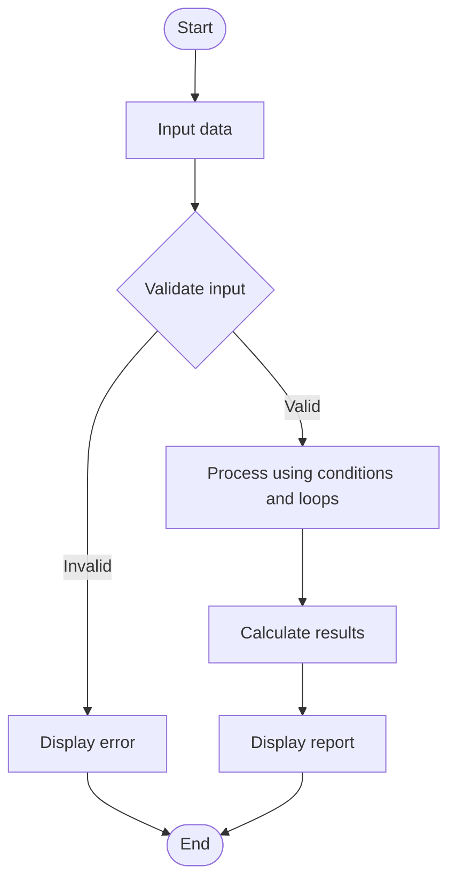

# Case Study 17: Student Performance Trend Analysis

## 1. Problem Statement
Compare a student's marks across multiple examinations, calculate improvements or declines, identify weak subjects, and classify performance.

## 2. Objectives
- Store subject marks for two examinations.
- Calculate subject-wise changes and averages.
- Identify weak subjects and classify overall performance.

## 3. Assumptions
- Marks are out of 100.
- The same subjects appear in both examinations.
- A subject is considered weak if the latest mark is below 40.
- Performance is Excellent at 85 or above, Good at 70 or above, otherwise Needs Improvement.

## 4. Algorithm
1. Start.
2. Read subject names and marks for two examinations.
3. Validate marks are between 0 and 100.
4. For each subject, calculate change and print improvement or decline.
5. Calculate latest average and identify weak subjects.
6. Classify performance using the stated thresholds.
7. Display the report and stop.

## 5. Flowchart
The flowchart below shows the general flow of this program. The validation and processing boxes correspond to the specific steps in the algorithm.



## 6. Pseudocode
```text
START
INPUT subject names and marks for Exam 1 and Exam 2
FOR each subject:
  change = Exam2 mark - Exam1 mark
  DISPLAY change as improvement, decline, or no change
CALCULATE latest average
FIND subjects with latest mark below 40
IF average >= 85, classification = Excellent
ELSE IF average >= 70, classification = Good
ELSE classification = Needs Improvement
DISPLAY report
STOP
```

## 7. Python Source Code
The complete runnable program is saved in [`program.py`](program.py).

```python
subjects = ["Python", "Mathematics", "English", "Physics"]
exam1 = []
exam2 = []

for subject in subjects:
    mark1 = float(input("Enter " + subject + " mark in Exam 1: "))
    mark2 = float(input("Enter " + subject + " mark in Exam 2: "))
    if mark1 < 0 or mark1 > 100 or mark2 < 0 or mark2 > 100:
        print("Invalid marks. Enter marks from 0 to 100.")
        raise SystemExit
    exam1.append(mark1)
    exam2.append(mark2)

print("\nSTUDENT PERFORMANCE REPORT")
total = 0
weak_subjects = []

for i in range(len(subjects)):
    change = exam2[i] - exam1[i]
    total += exam2[i]
    if change > 0:
        trend = "Improved"
    elif change < 0:
        trend = "Declined"
    else:
        trend = "No change"
    print(subjects[i], ":", trend, "(" + str(change) + " marks )")
    if exam2[i] < 40:
        weak_subjects.append(subjects[i])

average = total / len(subjects)
print("Latest average:", round(average, 2))
print("Weak subjects:", weak_subjects if weak_subjects else "None")

if average >= 85:
    print("Performance: Excellent")
elif average >= 70:
    print("Performance: Good")
else:
    print("Performance: Needs Improvement")
```

## 8. Test Cases
- **Input:** Exam 1: 60,70,80,50; Exam 2: 70,65,90,35
  **Expected result:** Python improved by 10; Mathematics declined by 5; English improved by 10; Physics declined by 15; average 65.0; Physics weak; Needs Improvement

**Note:** Run the program with the test inputs above and capture the actual console output for the submission screenshots.

## 9. Output Screenshot
Add a screenshot of the program running here after executing `program.py`.

Suggested filename: `output.png`

## 10. Conclusion
The program compares examination marks, identifies changes and weak subjects, and classifies performance.
